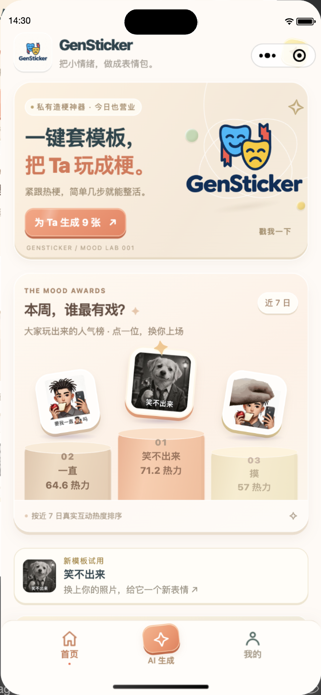
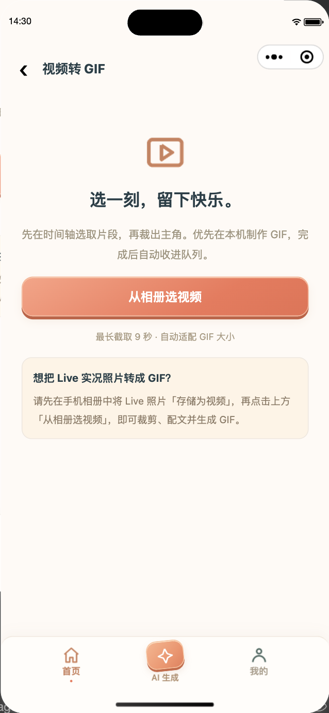

# GenSticker · 表情包生成器

GenSticker 是一个微信小程序。你可以套用模板制作表情包、上传照片自动搭配九张表情、把视频转成 GIF，也可以制作自己的模板。

当前是可供开发验收的版本，**尚未完成正式上线验收**。本轮修复与复测见 [整改报告](docs/testing/REMEDIATION_2026-10-20.md)，初始问题见 [测试报告](docs/testing/REPORT_2026-10-20.md)。代码和文档可以交接，不代表现有服务器已经适合对公众开放。

<p>
  
  
</p>

截图来自微信开发者工具，不代替实体手机验收。

## 功能说明

### 1. 浏览和选择模板

首页按“全部、仅文字、仅图片、图文混合”分类展示模板，每页九个，支持翻页。搜索框按名称、关键词或标签即时筛选，支持“猫 动图”“狗，动图”和“猫咪快乐动图”等组合与连写查询。关键词覆盖人物、角色、动物、情绪、动作和使用场景，例如“哈基米”“社畜”“ikun”“ASCII”；同义词基于模板已有信息扩展，不把“不开心”直接当成“开心”。可以按人气或时间排序，也可以查看自己的模板。人气榜来自本小程序中的有效使用记录，并不是全网热搜榜。

点击模板，可以查看需要的图片和文字数量、默认文字、作者及来源。点击星标可收藏；最近打开的模板会进入浏览历史。2026-10-30 线上目录为 **967 个模板**：图片类 328、图文类 163、文字类 476，其中 400 个支持动态输出。数字以实际服务目录为准，历史批次中的 1,000 个不代表当前仍全部发布。此前以改字为主的 650 个动图批次已按用户要求撤销，没有发布。当前改用 Tenor 猫咪素材；用户逐项通过的 8 个已按具体所选方案入库；另有 2 个眼部修订与 40 个新增换脸动图，共 42 项尚未入库，包含新近通过、等待发布的项目；具体标注以审核页为准。本轮新提供 23 个换脸动图，黑猫无语凝视按反馈改为半垂眼睑第 3 版，仍待复审。审核页现提供全部 50 个有效成品的全脸 GAN 对照，可在顶部切换预览；新增来源继续去重、定位和实测，待审数不计为已发布数。目标仍为约 1,500 个，未审核的模板不会入库。

### 2. 套模板制作表情

1. 打开一个模板，按提示上传图片、填写文字。
2. 上传后会自动寻找候选人物，点选后可拖动和缩放选框；也可以手动框选。选人、旋转、翻转、去背景、撤销和还原都在同一个编辑窗口完成。游客也可以识别，无需为此登录。
3. 可以撤销最近四步编辑，或还原原图。多张图片分别编辑。
4. 点击生成，等待完成后预览、保存或使用微信提供的分享入口。

静态模板输出静态图片，动画模板可以输出 GIF。少数兼容模板支持手机本机合成，其余模板交给服务器处理。手机照片的旋转标记会用于预览和压缩尺寸，竖图不会被横向拉伸。人脸较小、遮挡或无法明确检测时，服务器会尝试提供“主体”边界候选；“主体”不表示确认识别到了人，仍需自己确认选区。识别失败可点“重新识别”，或继续手动框选。自动检测必要时会临时向自己的服务器发送照片，只返回坐标，不创建素材或保存检测照片。

2026-10-29 按逐模板评价更新了 13 个表情驱动配方：11 个使用小型 GANimation CPU 模型，2 个使用轻微几何形变。其余模板保留原配方；模型缺失或照片无法处理时仍走图片槽回退。动作曲线、位置和遮挡均在制模时预先确定，不会自动把所有模板切换到同一个算法。选择结果、验证和回滚信息见 [本轮更新记录](docs/testing/SELECTED_EXPRESSION_DRIVERS_2026-10-29.md)。

去背景先复用图片已有的透明通道，再尝试微信本机模型；设备不支持、超时或识别不明确时回退服务器。本机模型只下载并缓存一次，照片不随模型下载上传。首次打开编辑器会在后台准备约 4.6 MB 的本机模型，模型校验后缓存，后续不重复下载。页面会提示本机是否就绪；本机模型和算子兼容性仍需在目标手机验收。回退时限制图片长边，使用微信原生文件上传、账号／游客绑定的短期结果地址和微信下载接口领取透明 PNG；下载会显示进度，可以关闭窗口，迟到结果不会覆盖原图。服务器预热模型并复用同图结果，不调用付费图片生成 API。网络超时、服务繁忙、识别不清和本机读图错误会显示对应提示，失败不会替换原图，可以调整选区后重试。

本机去背景的验收方法：先在真机打开编辑器，等待“本机去背景已就绪”，再关闭网络、选择已在手机上的照片并尝试去背景。兼容设备应能完成，且请求列表中没有照片上传；不兼容设备仍会尝试服务器回退。微信开发者工具不执行这条本机推理路径，不能用模拟器代替真机验收。模型首次下载、较低性能手机和不同微信版本的耗时需要分别实测。

模板各自的输入要求不同。名字模板会明确要求填写名字；“我永远喜欢”按图片数量填写对应名字。**不是所有模板成品都已验证能直接添加为微信表情**；部分 GIF 较大，可以在预览中选择“保存微信适配版”，保留原版另行保存。适配版长边不超过 240 px、500 KiB，可能降低清晰度或帧率；最终仍需以微信入口验收为准。

### 3. 照片自动搭配九张表情

从底部“AI 生成”进入，登录后选择照片。建议上传包含单个清晰主体的图片。

- 系统尝试标出可选人物／动物区域；你也可以手动移动、缩放框，选择真正想用的主体。
- 确认后截取该区域，之后不会擅自换成另一张脸。
- 服务器进行去背景和模板匹配，生成一组九张结果；支持的动画模板会保留动态。
- 可以放大、选择多张、保存所选结果，或点击“换一批”。换批复用原照片，优先避开上一批模板。
- 历史任务可重新打开。部分模板失败时会尝试补位；素材或服务异常时仍可能失败，会显示原因。

这里的“AI”指本地模型的主体处理和模板推荐，不是付费大模型重新绘画。检测不保证覆盖所有动物、遮挡或复杂人群，始终可以手动框选。默认没有每日生成次数上限，但同一账号同时仅有一个推荐任务，并有每分钟 8 次、每小时 80 次的频率保护；GIF 等入口也使用生成频率账本。

照片搭配使用支持单图输入、默认文字足够且通过渲染检查的模板。2026-10-21 验收时池中有 693 个，不是固定 18 个；图库里的配文模板、多图模板或需另填名字的模板不一定适用。新版 AI 页会显示服务端实际池大小，换批优先使用未用过的模板，池用完后仍会循环。

### 4. 视频转 GIF

从首页“视频转 GIF”进入，只选择相册中的视频。

1. 在时间轴中选取最长 9 秒的片段。
2. 框选需要保留的画面，可旋转、翻转。
3. 添加文字，拖动位置，调整字号、颜色、粗细和背景。
4. 生成 GIF，预览后保存或分享。

兼容设备优先本机生成；无法本机处理时压缩视频并提交后台。视频转 GIF 成品限制为长边不超过 240 px、文件不超过 500 KiB（512,000 字节）。可以选择均衡、流畅优先或清晰优先；复杂画面可能降低分辨率、色彩或帧率。建议截取 3～6 秒。

**Live 实况照片需要先在手机相册中“存储为视频”，再到小程序选择这个视频。**当前不提供直接上传 Live 照片的按钮。

### 5. 等待页面和生成队列

生成时可以留在等待页面，完成后直接看成品；收起等待页面后，可到“我的 → 生成队列”查看。队列支持未读提示、预览、保存、重新制作以及删除已经完成的任务。进入前会预取列表，优先展示缓存记录；列表只加载小缩略图，点开时再下载完整作品。

已被服务器接受的任务不会因为离开页面而取消。手机本机制作仍受微信和操作系统的后台运行限制；小程序被系统结束时，不能保证本机任务继续。服务器任务及结果通常保留七天。

### 6. 制作自己的模板

首页“我的梗，我来造”进入创作页，需要登录。

- **手动制作：**设置背景，添加图片槽和文字，拖动和调整图层，填写模板名称。
- **私藏：**保存为只有自己可以查看和使用的模板。
- **发布：**确认拥有素材使用与公开权利后，进入内容检查；检查未通过或服务不可用时保持私有／待处理，不自动公开。
- **AI 识图制模：**识别图片边缘可替换的文字，尽量保留原图表情、动作和场景。复杂、倾斜、低置信度或动画图片可能要求改用手动制作。这个入口每天最多成功一次，失败会退回机会；每小时最多尝试三次。识别不足时转为手动；可可靠保留场景但文字置信度稍低时，仅生成私有草稿。到“我的 → 管理素材与账号”校对文字，保存并查看预览，明确确认后才申请微信内容检查。

自动识图制模不是任意图片都能变成可换脸模板，也不会自动执行模型生成的代码。用户素材的使用与公开责任不能由一次勾选替代，模板详情提供举报入口，维护者可使用本机工具下架；正式运营仍需真实联系人和处理流程。

### 7. 登录、收藏和历史

微信一键登录后，可以主动选择头像、修改昵称。游客收藏和浏览记录会尝试合并到当前账号；已登录记录支持跨设备同步。收藏及浏览历史各最多保留 100 条。

登录会话为七天。退出登录会清除当前会话并请求服务端撤销；不同账号的本机缓存分开保存。个人推荐可以关闭，关闭后不再用后续选择更新偏好。

“我的 → 管理素材与账号”可查看空间、删除视频和自制模板、撤回发布及注销账号。注销会删除当前在线数据并撤回公开模板；尚有制作中的任务时需等待完成。下载到相册或其他设备的副本无法撤回，备份有独立保留期；少量防滥用摘要保留约 31 天。模板详情可举报，维护者通过本机工具核查和下架。

### 8. 模板维护和采集

后台定期检查已配置的素材来源。本轮按用户要求关闭定时模型自动发布，保留六小时素材采集，新增模板须逐项人工审核后入库。部署时运行 `sh deploy/require-human-template-review.sh`，在制模服务最后加载人工审核策略，避免旧模型开关覆盖该要求。部分来源当前连接不稳定，不能承诺持续获取所有热门表情。

离线批量制模遵循 `meme-to-template` skill。2026-10-30 的 ChineseBQB / 闪萌批次因改字过多、换脸过少而撤销，保留评价与历史证据，不再作为入库批准。新方向使用用户指定的 Tenor 猫咪素材，优先在原场景中融合上传者自己的五官，保留猫耳、身体、道具、原字幕和时序；不粘贴模板眼嘴。先以三张获准头像制作 10 个动图、90 份方案对照，明显失真的 GAN 方案禁选，侧脸、遮挡或跟踪不可靠的素材暂缓。首批用户通过 5 个（4 个 GANimation、1 个几何驱动）；15 份完整测试动图与审核版本字节一致。人工选择绑定模板及所选方案哈希，导出与恢复均验证审核证据、技术检查和来源。流程与限制见[Tenor 换脸审核记录](docs/testing/TENOR_FACE_REVIEW_2026-10-30.md)；[已撤销批次记录](docs/testing/TEMPLATE_EXPANSION_REVIEW_2026-10-30.md)及[更早扩充记录](docs/testing/TEMPLATE_EXPANSION_2026-10-21.md)保留为历史。

## 数据如何处理

图片不发送给外部付费 AI。推荐原图及处理缓存通常保留 24 小时，任务和结果通常保留七天，反馈最长保留 90 天。私有结果需要登录并校验归属。

发布自制模板时，会把必要内容交给微信内容安全接口检查；使用微信登录也需要访问微信接口。因此“模型在本机服务器运行”不等于“所有内容永远不经过外部服务”。头像、已保存模板和部分状态有不同的保留规则，不能把“七天保留”套用到全部数据。详见 [数据与隐私说明](docs/PRIVACY_DATA.md)。

## 开发环境

本仓库根目录包含 `frontend/` 和 `backend/`。在当前工作机上，实际 Git 仓库是外层项目的 `source/` 目录，`app/` 是旧副本，不用于本轮开发。

- 前端：uni-app、Vue 3、Vite 5；主要交付目标为微信小程序。
- 后端：Python 3.12、FastAPI、Pillow、Skia、SQLite。
- 模型：ONNX Runtime、U2NetP、FERPlus、OpenCV；识图制模另使用 RapidOCR。
- 建议使用已验证的 Node.js 24；本轮 Python 为 3.12。

### 运行微信前端

安装 Node.js、npm 和微信开发者工具，并登录微信开发者工具，开启官方 CLI 服务端口。

```sh
git clone --branch codex/rebuild-meme-slots git@github.com:MIKL2077/GenSticker.git
cd GenSticker/frontend
npm ci
npm run open:mp-weixin
```

该命令编译正式微信产物，并正常导入不含旧本机设置的临时项目。开发者工具基础库固定为已验证的 3.17.5，构建检查及原生验收会核对版本。若控制台出现本地 `/__dev__/WAServiceMainContext.js` 或 `WAAutoService.js` 的 500、页面白屏，应检查开发者工具基础库是否下载完整，以及项目本机设置是否覆盖了版本；重新运行该命令导入当前构建。微信端固定连接当前公网 API；域名校验保持开启。需要新预览码时运行：

```sh
npm run preview:mp-weixin -- --qr-output /tmp/gensticker-preview.png
```

AppID 在 `src/manifest.json` 中。更换为自己的小程序时，还需要修改后端 AppID、配置 AppSecret，并在微信后台配置 request、uploadFile、downloadFile 合法域名。**AppSecret 只能放在后端环境中。**本轮已修复生产构建在微信二次转译后白屏的问题，不能只以 H5 构建成功作为微信验收依据。

### 本地后端

```sh
python3.12 -m venv .venv
. .venv/bin/activate
python -m pip install --upgrade pip
python -m pip install -e ./backend/meme-generator -r deploy/requirements-features.txt
export GENSTICKER_STATE_DIR=/tmp/gensticker-dev-state
mkdir -p "$GENSTICKER_STATE_DIR"
cd backend/meme-generator
uvicorn meme_generator.app:app --host 127.0.0.1 --port 3001 --workers 1
```

Linux 还需要 FFmpeg、Fontconfig、中文字体和图形运行库。模型权重不随仓库提供；按 [模型许可和哈希](deploy/model-licenses/MODELS.md) 准备，设置 `U2NET_HOME`。未配置微信密钥时可测试游客功能；微信登录需要服务端配置 `WX_APPID`、`WX_APP_SECRET`。

图片解析当前使用 Pillow 12.3.x；依赖安全公告仍需在正式上线前处置，不能据此视为安全验收已完成。仓库内 `backend/pil-utils` 是保留上游 MIT 许可的兼容分支，用于解除旧 Pillow 上限；不要强制绕过依赖安装。旧 `poetry.lock` 已移除，避免把运行环境降回旧解析器。安全边界及仍需验收的内容见 [安全说明](SECURITY.md)。

API 之外，还需要运行独立 worker，推荐和生成队列才会处理：

```sh
python -m meme_generator.features.worker
```

API 与 worker 必须使用相同的私有状态目录；需要模型时使用正确的模型环境。H5 可用于辅助开发：

```sh
cd frontend
cp .env.example .env.local
npm run dev:h5
```

`.env.local` 中的地址覆盖仅适用于 H5；微信构建不会被它改成本地 HTTP。H5 不能代替微信的登录、相册、分享和后台行为验收。

## 测试

在仓库根目录，使用装有后端依赖的 Python 运行：

```sh
.venv/bin/python tools/qa/run_local.py --build
```

它会隔离测试数据库，运行前端检查、账户与功能后端测试，以及两端构建；实际组数与结果写入该命令生成的报告。微信原生检查需要已登录的开发者工具：

```sh
cd frontend
npm run test:mp-weixin
```

搜索交互可另运行 `node frontend/scripts/verify-template-search.cjs /tmp/gensticker-search-check`，通过实际微信输入事件验证线上关键词和连写查询。离线制模与审核工具使用方法见[本轮审核记录](docs/testing/TEMPLATE_EXPANSION_REVIEW_2026-10-30.md)。审核照片、原始素材、草稿配方和样张均留在私有工作目录，不提交到代码仓库。

测试计划、性能口径、每项功能的覆盖范围、原始证据和不能自动验证的项目见 [测试说明](docs/testing/TEST_PLAN.md) 与 [本轮报告](docs/testing/REPORT_2026-10-20.md)。不要把生产测试脚本当作压测工具直接对线上执行。

## 空间、排队和流量保护

默认每账号保留空间 256 MiB、每日素材上传预算 300 MiB、自制模板 100 个、视频／GIF 素材 100 份、照片素材 100 份、任务 200 条。删除旧内容可释放空间；失败上传尝试也可能计入当天预算，注销重登不能重置。进入限额时按提示到管理页面清理，照片还可复用“换一批”。

全局状态目录默认最多 12 GiB，系统盘空闲低于 10 GiB 时停止新写入。大素材请求在解析前最多接纳两个，减少多人上传时的内存峰值。部署参数见 [示例](deploy/resource-limits.env.example)。

应用响应流量默认规划 900 GB／账期，达到 85% 时暂停新生成、预留流量领取旧作品；达到总上限后暂停下载，保留登录、删除和健康接口。这是从计量启用后记录的应用流量；全机其他业务、协议开销及此前用量仍以云账单为准，需核对真实账期。

## 部署和交付

资源规划示例为 4 核 16 GB、每月 1500 GB；与主页或代理服务共用主机时，需要一起分配预算。本轮已加入图片依赖修复、磁盘配额和资源隔离；上线前仍需可信主机与凭据验收、剩余依赖公告处置和真机验收。当前不建议直接公开上线，也没有进行无限并发或破坏性压力测试。

- [部署、备份和回滚](docs/OPERATIONS.md)
- [上线检查和交接清单](docs/RELEASE_CHECKLIST.md)
- [待修改功能及优先级](docs/ROADMAP.md)
- [安全边界与已知风险](SECURITY.md)
- [参与开发](CONTRIBUTING.md)
- [素材、模型与代码许可](NOTICE.md)

开发过程中的历史记录保留在 [旧 README](docs/archive/README_BEFORE_DELIVERY.md) 和 `deploy/`。这些记录中的旧功能、模板数量、域名设置及验收结论，以本 README 和最新报告为准。
