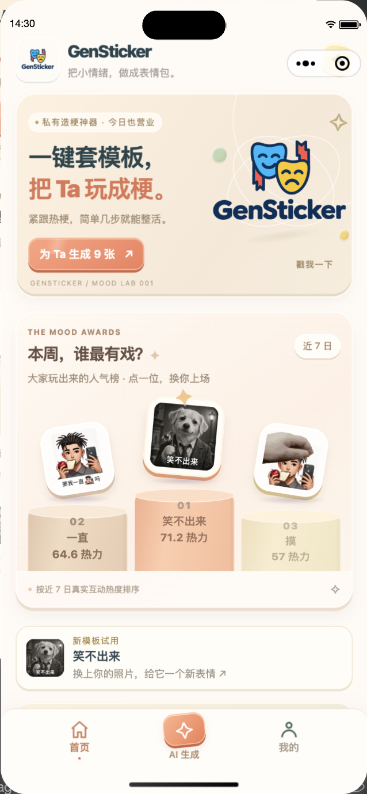
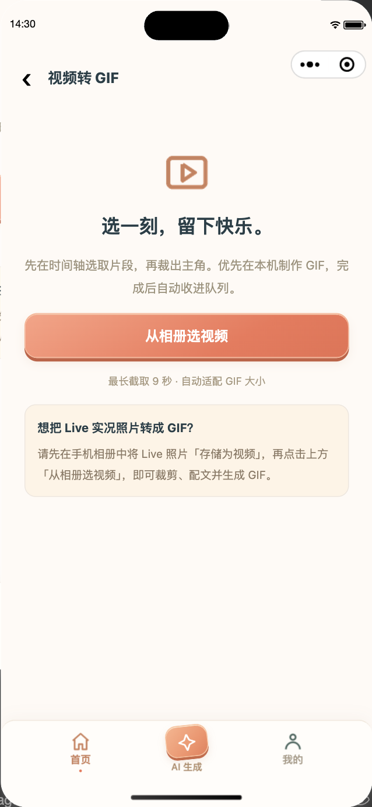

# GenSticker · 损友表情生成器

GenSticker 的微信小程序线上名称为 **损友表情生成器**。你可以套用模板制作表情包、上传照片自动搭配九张表情、把视频转成 GIF，也可以制作、私藏和发布自己的模板。

本文按 **2026-11-04** 的源码和线上接口整理。线上已有可使用的小程序；最新代码及 GitHub 默认分支为 `main`，`template-archive` 单独保存模板归档。本轮新功能已构建并通过开发者工具验证，仍需真机验收和上传微信后才会进入线上前端。

- 线上模板库：**1,010 个**，仅图片 355、图文混合 163、仅文字 492，其中 433 个支持动画；照片推荐可用池为 460 个。数量以 `/memes/categories` 和 `/recommend/catalog` 实时返回为准。
- 最近入库：奶龙动图 6 项、中文日常 7 项、主内梗图 3 项；本批 16 项按逐项评审通过后发布，4 项否决未发布。
- 后端已部署完整示例图接口和搜索别名扩充。模板示例直接分享、停止小程序本机模型初始化等前端改动已在源码中实现，尚待本轮新包真机验收。
- 当前微信开发者工具的网络证书问题已恢复，已成功授权 AppID、生成本轮预览码，并在基础库 3.17.5、合法域名校验开启的环境下完成七个页面及搜索、示例分享、编辑、拼图验证。实体手机的帧率、真实保存／分享仍待验收。逐项覆盖及性能优化顺序见 [功能与性能报告](docs/testing/FUNCTION_AND_PERFORMANCE_2026-11-04.md)。

本文先介绍前端用户功能，再列出后端能力、开发测试、部署和数据规则。历史试验、已撤销模板批次与待审核草稿均不计入已上线数量。

<p>
  
  
</p>

截图来自微信开发者工具，不代替实体手机验收。

## 前端功能

### 1. 浏览和选择模板

首页按“全部、仅文字、仅图片、图文混合”分类展示模板，每页九个，支持翻页。搜索框按名称、关键词或标签即时筛选，支持“猫 动图”“狗，动图”和“猫咪快乐动图”等组合与连写查询。关键词覆盖人物、角色、动物、情绪、动作和使用场景，例如“哈基米”“社畜”“ikun”“ASCII”；同义词基于模板已有信息扩展，不把“不开心”直接当成“开心”。可以按人气或时间排序，也可以查看自己的模板。人气榜来自本小程序中的有效使用记录，并不是全网热搜榜。

点击模板，可以查看需要的图片和文字数量、默认文字、作者、来源及输入提示。详情中的“分享这张示例”无需先上传照片或生成，使用完整静态图或 GIF。点击星标可收藏；最近打开的模板会进入浏览历史。关键词包含奶龙简繁体、拼音，以及主内、基督徒、阿们、感谢主、代祷等别名；仅依据模板已有语义扩展，避免把普通祈祷动作误归为宗教主题。

首页还提供精选／新模板试用卡，按已发布批次和日期轮换，记录当前访客的使用状态；标签不代表全网热度。模板撤回、封禁或归档后不再作为有效公开模板提供。

### 2. 套模板制作表情

1. 打开一个模板，按提示上传图片、填写文字。
2. 上传后会自动寻找候选人物，点选后可拖动和缩放选框；也可以手动框选。选人、旋转、翻转、去背景、撤销和还原都在同一个编辑窗口完成。游客也可以识别，无需为此登录。
3. 可以撤销最近四步编辑，或还原原图。多张图片分别编辑。
4. 点击生成，等待完成后预览、保存或使用微信提供的分享入口。

静态模板输出静态图片，动画模板可以输出 GIF。少数兼容模板支持手机本机合成，其余模板交给服务器处理。手机照片的旋转标记会用于预览和压缩尺寸，竖图不会被横向拉伸。人脸较小、遮挡或无法明确检测时，服务器会尝试提供“主体”边界候选；“主体”不表示确认识别到了人，仍需自己确认选区。识别失败可点“重新识别”，或继续手动框选。自动检测必要时会临时向自己的服务器发送照片，只返回坐标，不创建素材或保存检测照片。

2026-10-29 按逐模板评价更新了 13 个表情驱动配方：11 个使用小型 GANimation CPU 模型，2 个使用轻微几何形变。其余模板保留原配方；模型缺失或照片无法处理时仍走图片槽回退。动作曲线、位置和遮挡均在制模时预先确定，不会自动把所有模板切换到同一个算法。选择结果、验证和回滚信息见 [本轮更新记录](docs/testing/SELECTED_EXPRESSION_DRIVERS_2026-10-29.md)。

去背景先复用图片已有的透明通道；需要识别时使用自有服务器预热的 U2NetP。2026-11-03 为处理真机整页冻结，停止在小程序启动、编辑和框选时创建本机推理会话，也停止启动微信本机人脸引擎。手动选框立即可用，自动候选框异步返回；图片上传限制长边，结果通过绑定账号／游客的短期地址领取。关闭窗口或切换账号后，迟到结果不会覆盖当前图片。网络不可用时仍能手动框选、旋转和翻转，新的抠图操作需要联网。

目录分批建立搜索索引，大目录与缓存索引异步持久化；像素扫描分批执行。视频 GIF 每次压缩共用一个有界采样调色板、逐帧让出执行时间，超高分辨率视频交给后台处理。这些修改消除已知的启动模型编译路径，不能替代不同手机的完整流畅度验收。详见 [示例分享与响应优化记录](docs/testing/TEMPLATE_FEATURES_2026-11-03.md)。

模板各自的输入要求不同。名字模板会明确要求填写名字；“我永远喜欢”按图片数量填写对应名字。**不是所有模板成品都已验证能直接添加为微信表情**；部分 GIF 较大，可以在预览中选择“保存微信适配版”，保留原版另行保存。适配版长边不超过 240 px、500 KiB，可能降低清晰度或帧率；最终仍需以微信入口验收为准。

### 3. 照片自动搭配九张表情

从首页或底部“一键生成”进入，登录后选择照片。建议上传包含单个清晰主体的图片。

- 系统尝试标出可选人物／动物区域；你也可以手动移动、缩放框，选择真正想用的主体。
- 确认后截取该区域，之后不会擅自换成另一张脸。
- 服务器进行去背景和模板匹配，生成一组九张结果；支持的动画模板会保留动态。
- 可以放大、选择多张、保存所选结果，或点击“换一批”。换批复用原照片，优先避开上一批模板。
- 分享所选结果时，点击“拼成动态 GIF”可将动图同时拼进一张循环 GIF；混选的静态图保持不动。制作完成后先预览，再分享或保存 GIF。全选静态图仍输出静态拼图。
- 历史任务可重新打开。部分模板失败时会尝试补位；素材或服务异常时仍可能失败，会显示原因。

这里的“AI”指自有服务器模型的主体处理、图像分析和模板推荐。检测不保证覆盖所有动物、遮挡或复杂人群，始终可以手动框选。默认没有每日生成次数上限，但同一账号同时仅有一个推荐任务，并有每分钟 8 次、每小时 80 次的频率保护；GIF 等入口也使用生成频率账本。

照片搭配使用支持单图输入、默认文字足够且符合推荐策略的模板。2026-11-04 线上可用池为 460 个；图库里的配文模板、多图模板或需另填名字的模板不一定适用。一键生成页显示服务端实际池大小，换批优先使用未用过的模板，池用完后仍会循环。

动态拼图优先由服务器合成已属于当前账号的生成结果，手机直接领取 GIF；只提交任务与所选位置，不重新上传照片。服务暂不可用时自动使用本机编码，复用整段动画的调色板，避免逐帧重新量化触发真机超时。按最长动图的完整一轮生成，较短动图按原速循环，静态图保持不动；透明局部帧会先还原再拼合。支持最多九张、单张动图最长 15 秒；成品限制为 2 MB，复杂组合自动降低尺寸、颜色或帧率，保持整段时长。关闭预览可取消请求和本机制作，迟到成品会清理。这是 GIF 动图，不是 iPhone Live Photo；实际保存、发送仍需在目标微信和手机上验收。

### 4. 视频转 GIF

从首页“视频转 GIF”进入，只选择相册中的视频。

1. 在时间轴中选取最长 9 秒的片段。
2. 框选需要保留的画面，可旋转、翻转。
3. 添加文字，拖动位置，调整字号、颜色、粗细和背景。
4. 生成 GIF，预览后保存或分享。

兼容设备优先本机生成；无法本机处理时压缩视频并提交后台。视频转 GIF 成品限制为长边不超过 240 px、文件不超过 500 KiB（512,000 字节）。可以选择均衡、流畅优先或清晰优先；复杂画面可能降低分辨率、色彩或帧率。建议截取 3～6 秒。

**Live 实况照片需要先在手机相册中“存储为视频”，再到小程序选择这个视频。**当前不提供直接上传 Live 照片的按钮。

### 5. 等待页面和生成队列

生成时可以留在等待页面，完成后直接看成品；收起等待页面后，可到“我的 → 生成队列”查看。队列支持未读提示、预览、保存、重新制作以及删除已经完成的任务。点击“多选拼图”，可按点选顺序选择 2～9 张已完成的图片，预览拼图后分享或保存；静态图输出高清静态拼图，混选动图会保留动画。云端作品复用服务端合成，本机未同步作品或服务暂不可用时使用本机合成。进入前会预取列表，优先展示缓存记录；列表只加载小缩略图，点开时再下载完整作品。

已被服务器接受的任务不会因为离开页面而取消。手机本机制作仍受微信和操作系统的后台运行限制；小程序被系统结束时，不能保证本机任务继续。服务器任务及结果通常保留七天。

### 6. 制作自己的模板

首页“我的梗，我来造”进入创作页，需要登录。

- **手动制作：**设置背景，添加图片槽和文字，拖动和调整图层，填写模板名称。
- **私藏：**保存为只有自己可以查看和使用的模板。
- **发布：**确认拥有素材使用与公开权利后，进入内容检查；检查未通过或服务不可用时保持私有／待处理，不自动公开。
- **AI 识图制模：**识别图片边缘可替换的文字，尽量保留原图表情、动作和场景。复杂、倾斜、低置信度或动画图片可能要求改用手动制作。这个入口每天最多成功一次，失败会退回机会；每小时最多尝试三次。识别不足时转为手动；可可靠保留场景但文字置信度稍低时，仅生成私有草稿。到“我的 → 管理素材与账号”校对文字，保存并查看预览，明确确认后才申请微信内容检查。

自动识图制模不是任意图片都能变成可换脸模板，也不会自动执行模型生成的代码。用户素材的使用与公开责任不能由一次勾选替代，模板详情提供举报入口，维护者可使用本机工具下架；正式运营仍需真实联系人和处理流程。

### 7. 登录、收藏和历史

微信一键登录后，可以主动选择头像、修改昵称。游客收藏和浏览记录会尝试合并到当前账号；已登录记录支持跨设备同步。收藏及浏览历史各最多保留 100 条。

登录会话为七天。退出登录会清除当前会话并请求服务端撤销；不同账号的本机缓存分开保存。个人推荐可以关闭，关闭后不再用后续选择更新偏好。

“我的 → 管理素材与账号”可查看空间、删除视频和自制模板、撤回发布及注销账号。注销会删除当前在线数据并撤回公开模板；尚有制作中的任务时需等待完成。下载到相册或其他设备的副本无法撤回，备份有独立保留期；少量防滥用摘要保留约 31 天。模板详情可举报，维护者通过本机工具核查和下架。

### 8. 模板维护和采集

后台定期检查已配置的素材来源。本轮按用户要求关闭定时模型自动发布，保留六小时素材采集，新增模板须逐项人工审核后入库。部署时运行 `sh deploy/require-human-template-review.sh`，在制模服务最后加载人工审核策略，避免旧模型开关覆盖该要求。部分来源当前连接不稳定，不能承诺持续获取所有热门表情。

离线批量制模遵循 `meme-to-template` skill，审核绑定模板、配方和方案哈希。Tenor 猫咪换脸模板在原场景中融合上传者五官，保留猫耳、身体、道具、固定字幕及完整时序；使用三张获准头像验证，明显失真、遮挡或跟踪不可靠的方案暂缓。2026-10-31 累计 35 项按所选方案入库，15 项否决、2 项暂缓。此前 ChineseBQB／闪萌改字批次已撤销，历史评价不能用于批准新批次。流程见[Tenor 换脸审核记录](docs/testing/TENOR_FACE_REVIEW_2026-10-30.md)及[已撤销批次记录](docs/testing/TEMPLATE_EXPANSION_REVIEW_2026-10-30.md)。

2026-11-04 已按用户逐项评审发布主题扩充批次：从 24 份来源制作 20 个改字草稿，16 项通过、4 项否决；通过项包括 6 个奶龙完整 GIF、7 个中文日常模板和 3 个主内模板，正式库从 994 增至 1,010。每项核对评审时配方哈希、素材哈希、默认重建、真实改字、留空、多行和动画；来源权利状态如实保留。此批为改字模板，不纳入照片推荐池。详情见[入库记录](docs/testing/TEMPLATE_RELEASE_2026-11-04.md)。

本机审核页按批次临时启动，2026-11-04 已停止并清理本次审核服务及运行标记。评审记录、素材和发布回执保存在私有目录；仓库保留离线制模与审核工具，服务不会随项目自动启动。

## 后端能力

### 模板目录与图像渲染

- 提供分类目录、稳定模板 key／UUID、版本、来源、标签、关键词、默认输入和图片／文字槽位元数据；支持原生模板及声明式模板。
- 提供完整示例图、动态缩略图、默认预览和客户端可用的模板描述／图层素材。列表预览有尺寸、帧数和缓存预算；完整示例独立领取，保留源动画。
- 支持 JSON、multipart 图片生成，处理 EXIF 方向、图片数量、空输入、文字溢出和像素上限。单次生成使用受限线程／并发，热门结果按输入及版本缓存。
- 声明式渲染支持背景、图片／头像槽、文本、逐帧位置与时序、保护区域和预先制作的去字底图。部分模板采用逐项审核过的 CPU 五官融合、几何驱动或 GANimation 表情配方；模型不可用时保留可用的图片槽回退。
- InSwapper 当前仅完成适配调研，未接入生产生成链路，见[调研记录](docs/testing/INSWAPPER_FEASIBILITY_2026-10-30.md)。
- 字符画等原生模板与普通图像／文字模板共用目录和生成入口。模板的实际输入能力以其元数据为准。

主要接口：`/memes/categories`、`/memes/keys`、`/memes/{key}/info`、`/memes/{key}/thumbnail`、`/memes/{key}/example`、`/memes/{key}/generate`、`/memes/{key}/client-template`、`/templates`。实现位于 `app.py`、`features/catalog.py`、`declarative.py`、`frame_render.py`、`template_examples.py`。

### 主体处理与照片推荐

- 游客和登录用户均可异步检测候选人物／主体；确认选区由用户决定。检测接口只返回候选框，不创建长期照片素材。
- U2NetP 在自有服务器进行去背景，复用透明通道、模型和有界缓存；multipart 上传结果使用绑定当前身份的短期随机下载票据。
- 照片上传经过格式检查、方向归一化、大小限制和同账号去重；推荐结合主体、图像特征、模板输入适配、偏好及多样性生成九图组合。
- 支持换批、排除之前使用的模板、失败补位、结果选择反馈、关闭个性化，以及查询实际推荐池和配额。
- 后端保留校验过哈希的旧客户端模型下载接口以兼容旧包；当前前端不再启动设备模型推理。

主要接口：`/recommend/subjects/detect`、`/images/subject-file`、`/images/subject-results/{token}`、`/images/templates/{key}/guide`、`/images/templates/{key}/overlay`、`/recommend/assets`、`/recommend/catalog`、`/recommend/jobs`、`/recommend/preferences`。实现位于 `features/subjects.py`、`portrait.py`、`vision.py`、`recommendation.py`、`recommend.py`、`editor.py`。

### 持久任务、视频与拼图

- API 接收任务后写入 SQLite，独立 worker 领取并执行推荐、手动生成、识图制模和视频任务；使用幂等键、租约、重试和进度状态，避免客户端重试重复创建。
- 手动任务和推荐任务按账号隔离，支持列表、状态、缩略图、原图、重做源数据、重新生成、未读数、标为已读及删除。
- 视频源、海报和结果均校验账号归属。服务器使用 FFmpeg 按裁剪、旋转、字幕、时长和大小要求生成 GIF，并接收本机生成的结果同步到队列。
- 推荐结果及手动队列作品可在服务端按选择顺序拼图；GIF 保留完整循环，静态图保持静止。合成串行准入、校验结果归属并限制尺寸、帧数、时长和输出体积。
- 提供微信适配导出及固定白名单分享封面；客户端通过微信原生保存／分享入口交付成品。

主要接口：`/studio/jobs`、`/studio/unread`、`/studio/jobs/collage`、`/recommend/jobs/{id}/collage`、`/studio/live/assets`、`/studio/live/jobs`、`/studio/live/results`、`/images/wechat-export`。实现位于 `features/studio.py`、`worker.py`、`livegif.py`、`result_collage.py`、`export.py`。

### 账号、创作与内容管理

- 微信 code 换取身份，服务端保存会话哈希和到期时间；支持个人资料、主动上传头像、退出撤销会话、游客收藏／历史合并及跨设备用户库同步。
- 自制模板支持图片／文字图层、私有保存、预览、再使用及公开发布申请。OCR 识图制模生成受限数据配方，保留失败／低置信度草稿供人工修改，不执行模型生成代码。
- 公开发布经过微信内容检查；检查失败或不可用时保留私有／待处理状态。支持校对自动识别文字、撤回发布、举报、维护者下架及模板封禁。
- 管理接口可查询空间、删除素材／模板／任务并注销账号；活跃任务保护、中断重试和关联缓存清理共同防止残留或跨账号操作。
- 热度按有效生成、收藏、选择等事件去重统计；试用卡按已发布批次或日期轮换，记录访客使用状态。

主要接口：`/auth/wechat`、`/auth/me`、`/auth/session`、`/account/profile`、`/account/library`、`/account/storage`、`/account`、`/studio/templates`、`/studio/templates/ai`、`/templates/reports`、`/templates/popularity`、`/templates/trial`。实现位于 `account.py`、`features/lifecycle.py`、`studio.py`、`popularity.py`、`trials.py`。

### 存储、采集、归档与运维

- SQLite WAL 保存账号和功能数据，图片／视频存放在私有状态目录；共享文件锁、素材引用检查、上传预算、账号配额、全局磁盘／文件数水位控制写入与清理。
- worker 定期清理到期照片、任务、视频、结果和反馈；小程序另有跨启动文件登记、使用中的文件保护、缓存上限和空闲分批回收。
- 素材采集支持来源记录、去重、断点批次、质量检查和离线声明式制模。定时任务当前只收集候选，新增模板须逐项人工审核；发布保存版本、哈希及回滚证据。
- 月度归档将符合条件的公共模板转存到独立 `template-archive` 分支，远端逐字节核验通过后才释放本地素材；私有／用户素材和仍被任务、作品或收藏引用的模板受保护。支持按原 UUID、版本和发布状态恢复。
- 提供 `/healthz`、有界缓存、请求体限制、生成频率控制、流量账本与预算熔断、Linux CPU／内存隔离、主机资源监测、加密备份、验证恢复及应用回滚脚本。

仓库提供的 systemd 定时配置：采集每六小时一次（00／06／12／18 点，最多延迟 20 分钟）；归档每月 1 日 04:00（最多延迟 20 分钟）；监测每 15 分钟；备份每日 03:20（最多延迟 10 分钟）。部署时核对实际启用状态、环境变量和人工审核覆盖文件，详见 [运维说明](docs/OPERATIONS.md)。

## 仓库结构

```text
frontend/src/pages/           微信首页、我的、用户库、一键生成、队列、创作、视频 GIF
frontend/src/components/      编辑、预览、详情、账号与数据管理组件
frontend/src/services/        网络、生成、主体选择、GIF、分享、缓存及文件生命周期
frontend/tests/               前端回归用例
frontend/scripts/             微信构建检查、预览和运行时验收
backend/meme-generator/       FastAPI、原生模板、声明式渲染和功能模块
backend/pil-utils/            保留上游许可的图片工具兼容分支
tools/collect/                素材发现、离线制模、人工评审及批准发布工具
tools/qa/                     隔离回归、模板检查与评估
deploy/                       服务、定时器、依赖、资源限制、备份和部署脚本
docs/                         测试、运维、数据说明和历史记录
skills/meme-to-template/      模板作者工作流和配方约束
```

## 数据如何处理

图片不发送给外部付费 AI。推荐原图及处理缓存通常保留 24 小时，任务和结果通常保留七天，反馈最长保留 90 天。私有结果需要登录并校验归属。

发布自制模板时，会把必要内容交给微信内容安全接口检查；使用微信登录也需要访问微信接口。因此“模型在本机服务器运行”不等于“所有内容永远不经过外部服务”。头像、已保存模板和部分状态有不同的保留规则，不能把“七天保留”套用到全部数据。详见 [数据与隐私说明](docs/PRIVACY_DATA.md)。

## 开发环境

本仓库根目录包含 `frontend/` 和 `backend/`。在当前工作机上，实际 Git 仓库是外层项目的 `source/` 目录，`app/` 是旧副本，不用于本轮开发。

- 前端：uni-app、Vue 3、Vite 5；主要交付目标为微信小程序。
- 后端：Python 3.12、FastAPI、Pillow、Skia、SQLite。
- 模型：ONNX Runtime、U2NetP、FERPlus、OpenCV；识图制模另使用 RapidOCR。
- 建议使用已验证的 Node.js 24；本轮 Python 为 3.12。

### 运行微信前端

安装 Node.js、npm 和微信开发者工具，并登录微信开发者工具，开启官方 CLI 服务端口。

```sh
git clone --branch main git@github.com:MIKL2077/GenSticker.git
cd GenSticker/frontend
npm ci
npm run open:mp-weixin
```

该命令编译正式微信产物，并正常导入不含旧本机设置的临时项目。开发者工具基础库固定为已验证的 3.17.5，构建检查及原生验收会核对版本。若控制台出现本地 `/__dev__/WAServiceMainContext.js` 或 `WAAutoService.js` 的 500、页面白屏，应检查开发者工具基础库是否下载完整，以及项目本机设置是否覆盖了版本；重新运行该命令导入当前构建。微信端固定连接当前公网 API；域名校验保持开启。需要新预览码时运行：

```sh
npm run preview:mp-weixin -- --qr-output /tmp/gensticker-preview.png
```

AppID 在 `src/manifest.json` 中。更换为自己的小程序时，还需要修改后端 AppID、配置 AppSecret，并在微信后台配置 request、uploadFile、downloadFile 合法域名。**AppSecret 只能放在后端环境中。**本轮已修复生产构建在微信二次转译后白屏的问题，不能只以 H5 构建成功作为微信验收依据。

动态拼图的回归与微信端验证：

```sh
node tests/result-collage.cjs
node tests/server-collage.cjs
node tests/queue-collage.cjs
node tests/ui-flows.cjs
npm run build:mp-weixin
npm run test:mp-weixin-collage -- --output-dir /tmp/gensticker-collage-proof
npm run test:mp-weixin-queue-collage -- /tmp/gensticker-queue-collage-proof
npm run test:mp-weixin-template-features -- /tmp/gensticker-template-features-proof
npm run test:mp-weixin-performance -- /tmp/gensticker-performance-proof
```

拼图验收脚本使用真实微信画布和文件系统，校验 GIF 帧数、完整时长、预览、缓存复用和临时文件清理；输入下载、服务器调用、相册保存和分享接口使用测试替身。模板示例验收脚本真实下载已部署接口的 GIF／PNG，检查文件格式、按钮、搜索和页面切换，并统计原生模型初始化次数及计时器间隔；分享菜单使用替身。脚本不向好友发送测试图片，也不写入真实相册。实体 iPhone／Android 的流畅度、实际保存和接收效果需另做真机验收。历史结果见[发布与 GIF 拼图验收](docs/testing/REVIEWED_TEMPLATES_AND_COLLAGE_2026-10-31.md)和[示例分享记录](docs/testing/TEMPLATE_FEATURES_2026-11-03.md)。

### 本地后端

```sh
python3.12 -m venv .venv
. .venv/bin/activate
python -m pip install --upgrade pip
python -m pip install -e ./backend/meme-generator -r deploy/requirements-features.txt
export GENSTICKER_STATE_DIR=/tmp/gensticker-dev-state
mkdir -p "$GENSTICKER_STATE_DIR"
cd backend/meme-generator
uvicorn meme_generator.app:app --host 127.0.0.1 --port 3001 --workers 1
```

Linux 还需要 FFmpeg、Fontconfig、中文字体和图形运行库。模型权重不随仓库提供；按 [模型许可和哈希](deploy/model-licenses/MODELS.md) 准备，设置 `U2NET_HOME`。未配置微信密钥时可测试游客功能；微信登录需要服务端配置 `WX_APPID`、`WX_APP_SECRET`。

图片解析当前使用 Pillow 12.3.x；依赖安全公告仍需在正式上线前处置，不能据此视为安全验收已完成。仓库内 `backend/pil-utils` 是保留上游 MIT 许可的兼容分支，用于解除旧 Pillow 上限；不要强制绕过依赖安装。旧 `poetry.lock` 已移除，避免把运行环境降回旧解析器。安全边界及仍需验收的内容见 [安全说明](SECURITY.md)。

API 之外，还需要运行独立 worker，推荐和生成队列才会处理：

```sh
python -m meme_generator.features.worker
```

API 与 worker 必须使用相同的私有状态目录；需要模型时使用正确的模型环境。H5 可用于辅助开发：

```sh
cd frontend
cp .env.example .env.local
npm run dev:h5
```

`.env.local` 中的地址覆盖仅适用于 H5；微信构建不会被它改成本地 HTTP。H5 不能代替微信的登录、相册、分享和后台行为验收。

## 测试

2026-11-04 完整隔离回归已通过：41 个前端测试脚本、237 个后端测试（账号 6 项、功能 231 项），以及微信小程序、H5 构建。补齐 Linux Skia 所需的 EGL 运行库后，GitHub Actions 的 regression 任务也通过；dependency-security 任务仍因依赖公告失败，不能将整个工作流视为全绿。微信开发者工具的七个页面、搜索、示例、编辑、两处拼图及交互计时验证通过，实体手机验收不包含在此结论中。详见 [逐项覆盖与实测数据](docs/testing/FUNCTION_AND_PERFORMANCE_2026-11-04.md)。

在仓库根目录，使用装有后端依赖的 Python 运行：

```sh
.venv/bin/python tools/qa/run_local.py --build
```

它会隔离测试数据库，运行前端检查、账户与功能后端测试，以及两端构建；实际组数与结果写入该命令生成的报告。微信原生检查需要已登录的开发者工具：

```sh
cd frontend
npm run test:mp-weixin
```

搜索交互可另运行 `node frontend/scripts/verify-template-search.cjs /tmp/gensticker-search-check`，通过实际微信输入事件验证线上关键词和连写查询。离线制模与审核工具使用方法见[本轮审核记录](docs/testing/TEMPLATE_EXPANSION_REVIEW_2026-10-30.md)。审核照片、原始素材、草稿配方和样张均留在私有工作目录，不提交到代码仓库。

若微信 CLI 获取 AppID 权限时出现 `UNABLE_TO_VERIFY_LEAF_SIGNATURE`，先检查开发者工具自身的代理设置。本机已验证 Node 直连微信域名成功，经 Reqable 8888 端口可复现证书链错误；明确选择直连并完全重启工具，或为微信连接配置合法的代理证书链／SSL 透传后再重试。保持 TLS 与小程序合法域名校验开启，故障记录见[11 月 4 日记录](docs/testing/TEMPLATE_RELEASE_2026-11-04.md)。

测试计划、性能口径、每项功能的覆盖范围、原始证据和不能自动验证的项目见 [测试说明](docs/testing/TEST_PLAN.md) 与 [本轮报告](docs/testing/REPORT_2026-10-20.md)。不要把生产测试脚本当作压测工具直接对线上执行。

## 空间、排队和流量保护

默认每账号保留空间 256 MiB、每日素材上传预算 300 MiB、自制模板 100 个、视频／GIF 素材 100 份、照片素材 100 份、任务 200 条。删除旧内容可释放空间；失败上传尝试也可能计入当天预算，注销重登不能重置。进入限额时按提示到管理页面清理，照片还可复用“换一批”。

全局状态目录默认最多 12 GiB，系统盘空闲低于 10 GiB 时停止新写入。大素材请求在解析前最多接纳两个，减少多人上传时的内存峰值。部署参数见 [示例](deploy/resource-limits.env.example)。

应用响应流量默认规划 900 GB／账期，达到 85% 时暂停新生成、预留流量领取旧作品；达到总上限后暂停下载，保留登录、删除和健康接口。这是从计量启用后记录的应用流量；全机其他业务、协议开销及此前用量仍以云账单为准，需核对真实账期。

## 部署和交付

资源规划示例为 4 核 16 GB、每月 1500 GB；与其他服务共用主机时，需要一起分配预算。部署提供图片依赖修复、磁盘配额和资源隔离。小程序已有线上版本，每次更新仍须核对服务配置、模板与模型版本、备份恢复和微信真机效果；本轮前端改动的真机验收状态见开头说明。运行环境、配置与业务数据分别交接，源码推送不等于部署或上传微信。

- [部署、备份和回滚](docs/OPERATIONS.md)
- [上线检查和交接清单](docs/RELEASE_CHECKLIST.md)
- [待修改功能及优先级](docs/ROADMAP.md)
- [安全边界与已知风险](SECURITY.md)
- [参与开发](CONTRIBUTING.md)
- [素材、模型与代码许可](NOTICE.md)

开发过程中的历史记录保留在 [旧 README](docs/archive/README_BEFORE_DELIVERY.md) 和 `deploy/`。这些记录中的旧功能、模板数量、域名设置及验收结论，以本 README 和最新报告为准。
