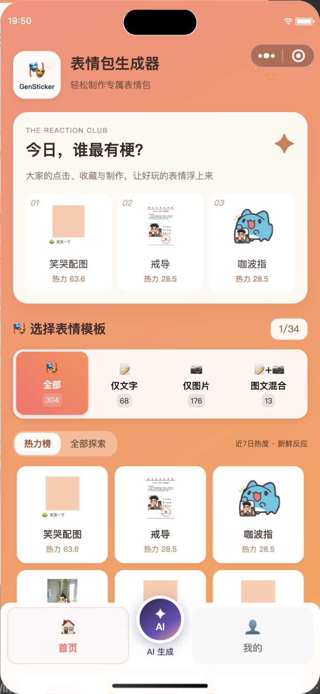
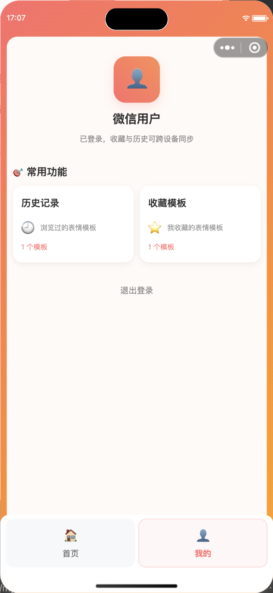
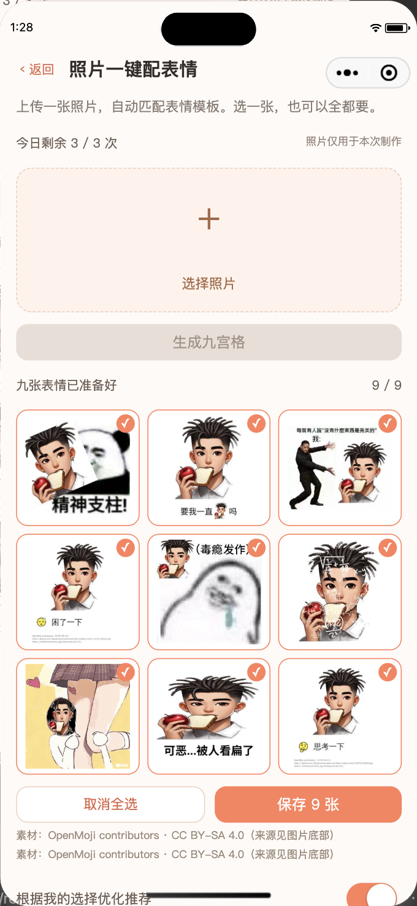

# GenSticker · 表情包生成器

GenSticker 是一个微信小程序：可以选择模板、替换图片和文字制作表情包，也可以上传一张照片，自动提取主体并生成一组最多九张的推荐表情包。

本文对应 **2026 年 10 月 14 日**的开发版本，开发分支为 `codex/restore-wechat-final`。前后端已部署并完成微信开发者工具验证，已生成私有开发预览，尚未提交微信审核或发布生产版本。

## 当前功能

### 模板浏览与手动制作

- 首页采用橙色渐变、模板卡片和底部“首页 / AI生成 / 我的”导航，AI 为独立圆形动效按钮，保留原有浏览与制作流程。
- 支持“全部、仅文字、仅图片、图文混合”分类，每页九个模板，显示数量、分页、加载占位和失败重试。
- 当前可用模板 **295 个**：294 个原有模板、1 个用户提供的“笑不出来”人脸与文字模板。之前新增的十个模板因用户验收不通过已撤下，启动与定时任务不再恢复。数量会随采集和发布变化；分类根据实际输入要求计算，零输入或可选输入模板可能只显示在“全部”。
- 模板详情展示输入数量、默认文字、参数约束；左上角星标收藏，最底部小字保留来源、作者及许可信息；按模板要求上传一张或多张图片、编辑文字并生成。
- 生成结果支持预览、保存到相册及微信原生分享。手动制作保留模板自身的静态图片或 GIF 输出。
- 支持收藏 / 取消收藏、最近浏览历史、清空历史，以及从历史或收藏重新打开模板。浏览历史最多保留 100 条。

### 微信登录与个人中心

- 未登录时，点击头像、历史记录或收藏模板会打开微信登录弹窗，支持主动选择头像、输入昵称。
- 后端使用 `wx.login` 获取的临时 code 完成微信身份验证；头像和昵称可以在登录后修改，支持退出登录。
- 游客记录保存在本地，登录后合并到当前账户；已登录用户的历史与收藏支持跨设备同步、同步失败重试。
- 会话有效期为七天；后端校验用户身份和数据归属，退出时撤销会话，客户端缓存按账户隔离。

### 照片一键配表情

从底部圆形“AI生成”按钮或首页“照片一键配表情”进入，登录后选择一张照片：

1. 客户端压缩照片，服务端校正方向并去除图片元数据。
2. 本地 CPU 模型 U2NetP 自动提取主体，多主体时选取最大连通主体；不确定时保留原图并提示。
3. 对检测到的人脸使用 FERPlus 分析视觉表情，结合图片比例、模板输入要求、标签偏好和多样性匹配模板。动物、物体、未检测到人脸或低置信度结果使用通用标签。
4. 异步生成最多九张静态 JPEG，预览逐张显示。支持单选、多选、全选、取消全选和保存所选图片。
5. 离开页面暂停轮询，后台任务继续；重新进入恢复最近任务，也可浏览、删除生成历史。

同一基础布局最多出现两张；合适模板不足或部分渲染失败时显示实际结果，不复制图片凑满九张。此入口输出静态 JPEG，手动模板入口仍可生成 GIF。

### 使用限额与个性化推荐

- 默认每用户每天 **3 次**、全站每天 **100 个任务**，按北京时间切日。同一用户同时只能有一个活动任务，全局活动队列最多十个。
- 服务端管理额度：相同幂等提交重试不重复扣次，失败任务退回次数，无效上传不扣正式次数。下载、选择结果不重复扣次，删除记录或清理客户端缓存不能重置额度。
- 记录实际可见的预览曝光和用户选择，每小时更新模板标签偏好；使用时间衰减、平滑位置校正、全选降权以及探索候选。
- 可以关闭个性化：清除已有反馈和偏好，后续选择不再用于学习，仍可正常生成和保存。
- 当前算法为 `tags-position-heat-v3`，结合全站热度与个人标签，是初版可解释排序，尚未进行大规模推荐效果实验。

### 自动采集、转换与模板管理

- 后端采集任务每六小时执行一次，并增加随机延迟；使用来源白名单、许可检查、下载预算、文件哈希与来源 URL 去重。
- 每个模板有稳定 UUID 和独立版本，原有模板 key 保留作为兼容别名；模板目录包含分类、标签、版本和署名。
- [meme-to-template Skill](skills/meme-to-template/SKILL.md) 将已许可图片转换为声明式模板。普通 meme 新转换优先保留原图主体、动作和场景，仅替换高置信度的边缘反应文字；不可靠 OCR、遮挡或主体替换会破坏笑点的素材进入待处理。历史主体槽位样例已撤下。按用户明确要求可进入人工审查的拆解模式，用人脸 / 文字槽位、受保护区域、清除遮罩和真实替换测试建立模板；与自动采集的保守门槛分开。
- 模板发布前校验图层边界、素材哈希并试渲染；普通图片转换还检查重建误差、固定区域像素与感知哈希 / 文字意图重复。低置信度候选保留待处理，不自动发布。
- 模板使用受限图层 DSL，不执行模型生成的任意 Python，也不允许模板加载任意远程素材。
- 当前“笑不出来”测试模板及其素材包含在种子包中，来源记录为用户提供、原始权利未核验，新环境首次启动自动恢复；重复恢复不重复入库，不覆盖已有较新版本。
- 下载预算为每日最多 100 个候选、200 MB，每月最多 1 GB；采集失败不会阻断用户制作。

**当前来源与边界：** 旧 OpenMoji 通用框架已停用；Wikimedia 已许可 meme 适配器已实现，但当前部署服务器访问该接口超时，会定期重试。普通 meme 转换已用公开许可样例验证。新增 ChineseBQB 候选元数据发现，已登记 18 项许可待核验候选，未下载或发布图片；爱给、闪萌登记为逐素材许可来源，尚未自动接入。当前并未覆盖“全网最新热门榜”，复杂遮挡、动画和不可靠 OCR 图片尚不自动发布。

### 性能与隐私

- 模板缩略图和生成结果使用本地文件路径，避免将大段 Base64 传入小程序 `setData`。
- 首页一次取得名称、输入约束、来源和热度，打开详情不再先等独立请求；预载相邻两页，前台图片优先，后台加载不触发全页占位。缩略图最多 96 个 / 8 MB，账户同步在后台进行。
- 2 个兼容模板支持微信本机 Canvas 合成：JPEG 输入的“一直”“看扁”静态布局。“笑不出来”使用预先拆解的图像槽位，模板旧主体在制作阶段清除；生成时直接合成上传图片，不要求检测到正面人脸。只下发受限 JSON 和已发布素材，不下载执行 Python 或任意代码；GIF、复杂布局、资源超限或不支持的设备自动回服务端。画布任务结束释放，公开素材缓存最多 24 个 / 8 MB。
- 本机结果先显示，统计回执异步发送；服务端对确定性模板使用按用户隔离的短期内存缓存，最多 16 项 / 8 MB / 120 秒，结果不设公共缓存。
- 大尺寸 JPEG 上传前缩放至最长边 1280 像素，手动入口保留透明或动画原图；阻止重复生成并明确提示超时、限速和服务繁忙。
- 图片模板详情提供“提取图片主体”开关，默认关闭：直接使用原图；开启后在服务器本地用 U2NetP 一次提取最大主体，再合成。透明图片复用 alpha，无需模型推理；可先使用“裁剪区域”选择头像，客户端不支持裁剪时提示相册裁剪。提取失败保留表单，可关闭后重试。该选项独立于 AI 九图入口。
- 手动主体提取缓存按用户和照片隔离，最多 8 项 / 8 MB / 120 秒；不落盘，不启用公共缓存。开关状态进入生成结果缓存键，避免混用结果。
- 推荐任务独立 worker 处理，模型预热后复用，同一照片处理结果可复用，九图最多并行渲染两张，预览下载最多并发三张。
- 用户照片不发送给外部 AI；模型只在本地 CPU 运行，付费 AI 调用关闭。成本账本记录本地 CPU / 字节用量及零 API 金额。
- 原图和处理缓存 24 小时后按小时清理，结果与任务保留七天，标签反馈最多保留 90 天；不保留人脸身份向量。
- 私有结果下载要求登录并校验任务归属，无公开用户图片目录。删除任务会清理对应图片和反馈。

### 全站热度与首页排序

点击、有效收藏、成功手动生成、本机生成及 AI 生成 / 曝光 / 选择 / 下载分别统计。使用账户或匿名安装标识去重，限制事件频率；服务端渲染仅成功计数，AI 结果按任务和槽位去重。热力值取北京时间最近七个自然日、三天半衰期，收藏、制作和选择权重大于点击，单纯曝光不增加热度，并使用平滑转化率。累计次数持续保留。

首页显示热度前三与热榜 / 探索切换；探索可浏览完整模板库，新模板冷启动明确显示“等你点燃”。AI 候选同时考虑输入兼容、表情、个人偏好、热度和多样性，保留探索机会。客户端生成成功回执含签名、有效期和防重放校验，但不是设备真实性证明，统计不作为计费依据。

首页“新模板试用”可以直接打开“笑不出来”；上传头像或其他图片替换狗头，可先裁剪并选择是否提取主体，枯花、爪子、西装和场景保留，文字仍可修改。默认和替换文字保留白色粗体、黑色描边及居中样式。AI 圆形按钮改为与页面统一的珊瑚红 / 暖橙渐变。详情与验收记录见 [本次模板验收](deploy/USER_TEMPLATE_ACCEPTANCE.md)。

其他模型可直接读取 [Skill](skills/meme-to-template/SKILL.md)、[拆解流程与 JSON 契约](skills/meme-to-template/references/decomposition.md)及[已测试的拆解示例](skills/meme-to-template/references/dog-reaction-brief.json)，在项目 Python 环境运行 `scripts/decompose.py`。包含图像槽位的脚本要求实际替换图片测试后才允许发布，不把原图预览当作换脸成功。当前执行适配器支持预定义图像和文字槽位；复杂动作 / 全身替换保留待处理。新增猫咪、Doge、农夫三种布局回归及失败记录，见 [多样本测试](skills/meme-to-template/references/multi-sample-tests.md)。数值达标仍需看图；新增样本保持待审核，不自动加入首页。

## 界面预览

以下为此前开发者工具验收截图；最新配色与模板状态以本次验收记录为准：

<p>
  
  
  
</p>

## 项目结构与技术栈

```text
frontend/                       uni-app、Vue 3、Vite 微信小程序前端
  src/pages/                    首页、个人中心、模板制作、库与推荐页面
  src/services/                 API、账户同步、缩略图缓存、推荐任务
  tests/                        前端服务与平台行为测试
backend/meme-generator/         Python / FastAPI 表情合成服务
  meme_generator/features/      模板目录、DSL、采集、视觉处理、推荐 worker
  tests/                        账户及新功能测试
skills/meme-to-template/         可复用转换 Skill 与执行辅助脚本
deploy/                         systemd、Nginx、配置、模型许可及验收文档
```

后端基于 [MemeCrafters/meme-generator](https://github.com/MemeCrafters/meme-generator)，使用 Pillow、Skia 合成图片，SQLite 存储账户与功能数据，ONNX Runtime 执行视觉模型，RapidOCR 处理离线模板文字。当前部署采用 Python 3.12；前端使用 Vue 3.4 / Vite 5。

## 本地运行

### 微信小程序

需要兼容 Vite 5 的 Node.js、npm，以及已登录的微信开发者工具。

```sh
git clone --branch codex/restore-wechat-final git@github.com:MIKL2077/GenSticker.git
cd GenSticker/frontend
npm ci
cp .env.example .env.local
npm run build:mp-weixin
```

在微信开发者工具中导入 `frontend/dist/build/mp-weixin`，项目配置的 AppID 为 `wx2e3a058ed0117034`。开发时可运行 `npm run dev:mp-weixin`，导入对应的 `frontend/dist/dev/mp-weixin` 目录。

`.env.local` 中配置后端地址，默认使用当前部署服务：

```dotenv
VITE_API_BASE_URL=https://www.shangkun.uk/gensticker/api
VITE_PROXY_TARGET=http://127.0.0.1:3001
```

联调本地后端时把 `VITE_API_BASE_URL` 改为 `http://127.0.0.1:3001` 并重新编译。开发工具关闭域名校验只适用于调试；真机使用 HTTPS，并在微信公众平台配置 request、uploadFile、downloadFile 合法域名 `https://www.shangkun.uk`，完善照片、头像和相册保存的隐私用途说明。

可运行 `npm run dev:h5` 或 `npm run build:h5` 开发 / 构建 H5。微信登录、原生分享和相册能力以微信端为验收目标，H5 构建通过不表示这些微信专属能力在浏览器可用。

### 后端 API

从仓库根目录执行：

```sh
python3.12 -m venv .venv
. .venv/bin/activate
python -m pip install -e ./backend/meme-generator
export GENSTICKER_STATE_DIR="$HOME/.local/share/gensticker"
mkdir -p "$GENSTICKER_STATE_DIR"
cd backend/meme-generator
uvicorn meme_generator.app:app --host 127.0.0.1 --port 3001 --workers 1
```

`GENSTICKER_STATE_DIR` 存放账户数据库、功能数据库和私有文件，须位于不对外提供静态访问的目录，且不能提交 Git。无微信密钥时可运行游客手动制作；微信登录与照片推荐需要在后端安全环境中配置 `WX_APPID` 和 `WX_APP_SECRET`。AppSecret 不写入前端或源码。

首次启动会登记内置模板并恢复“笑不出来”测试模板。模板 / 字体资源及系统图形依赖需完整，字体与模板配置参见 [部署文档](deploy/README.md)。当前“典中典”需要百度翻译凭据，部署配置中暂时禁用。

### 推荐 worker 与采集

仅启动 API 不会处理照片推荐队列，还需安装 CPU 模型运行依赖并启动独立 worker。当前服务器使用独立虚拟环境，安装方法见 [install-feature-runtime.sh](deploy/install-feature-runtime.sh)；此脚本针对 `/opt/gensticker-*` 部署布局，不应直接当作任意本地环境的一键安装脚本。

准备 U2NetP、FERPlus 模型文件，设置 `U2NET_HOME` 指向模型目录，并按 [模型来源、哈希及许可](deploy/model-licenses/MODELS.md) 核验。模型权重不包含在 Git 中，不在用户请求期间自动下载。API 与 worker 使用相同的 `GENSTICKER_STATE_DIR` 和账户环境配置。

在具备这些依赖的运行环境中，从 `backend/meme-generator` 执行：

```sh
python -m meme_generator.features.worker
```

采集执行器为 `meme_generator.features.ingest`，转换说明见 [Skill](skills/meme-to-template/SKILL.md)。生产定时执行配置见 [采集 service](deploy/gensticker-ingest.service) 和 [timer](deploy/gensticker-ingest.timer)。

## API 与部署

当前 HTTPS API 前缀：`https://www.shangkun.uk/gensticker/api`。主要接口如下（路径相对此前缀）：

- 健康与模板：`GET /healthz`、`GET /memes/categories`、`GET /templates`、`GET /memes/{key}/info`、`GET /memes/{key}/thumbnail`。
- 热度与端侧模板：`GET /templates/popularity`、`POST /templates/events`、`GET /memes/{key}/client-template`、`GET /template-assets/{hash}.png`；来源状态：`GET /templates/sources`。
- 手动生成：`POST /memes/{key}/generate`，小程序使用 JSON 输入并接收图片；兼容原有表单生成接口。
- 登录与资料：`POST /auth/wechat`、`GET /auth/me`、`DELETE /auth/session`、`PUT /account/profile`。
- 用户库：`GET /account/library`、`POST /account/library/merge`，以及历史 / 收藏的写入、删除接口。
- 推荐：`POST /recommend/assets` 上传照片、`GET /recommend/quota` 查询额度、`POST /recommend/jobs` 创建任务、`GET /recommend/jobs` 查询历史、`GET /recommend/jobs/{id}` 查询进度。
- 私有结果与反馈：`GET /recommend/jobs/{id}/results/{slot}`、`POST /recommend/jobs/{id}/selections`、`PUT /recommend/preferences`、`DELETE /recommend/jobs/{id}`。

账户私有接口与推荐接口使用 Bearer 会话认证。照片上传上限 3 MB，服务端拒绝超过 2400 万像素的图片；手动入口客户端原图总量上限 10 MB。推荐每日额度可由 `GENSTICKER_DAILY_LIMIT`、`GENSTICKER_GLOBAL_LIMIT` 配置。

部署使用 Nginx + Cloudflare Tunnel + 独立 API / worker / 采集服务，API 仅监听回环地址。服务采用非 root 用户、资源限制和受限写目录，Nginx 对生成与上传限速。

- `gensticker.service`：API；`gensticker-worker.service`：照片处理与推荐；`gensticker-ingest.timer`：定期采集。
- 状态目录：`/var/lib/gensticker`；模型目录：`/var/cache/gensticker/models`。
- 观察日志：`journalctl -u gensticker-worker`、`journalctl -u gensticker-ingest`。
- 备份应包含账户 / 功能数据库及模板素材，使用一致性备份或停服务备份，避免只复制 SQLite 主文件而遗漏 WAL 数据。

安装、路由、数据备份、回滚和既有服务器维护记录见 [deploy/README.md](deploy/README.md)；功能验收与当前限制见 [FEATURES_ACCEPTANCE.md](deploy/FEATURES_ACCEPTANCE.md)；本轮优化、实测与回滚记录见 [OPTIMIZATION_ACCEPTANCE.md](deploy/OPTIMIZATION_ACCEPTANCE.md)。

## 测试与验收

从仓库根目录运行前端测试和构建：

```sh
node frontend/tests/library.cjs
node frontend/tests/weixin-generation.cjs
node frontend/tests/thumbnail-cache.cjs
node frontend/tests/recommend-service.cjs
node frontend/tests/client-renderer.cjs
node frontend/tests/template-paging.cjs
npm --prefix frontend run build:mp-weixin
npm --prefix frontend run build:h5
```

在已安装后端及功能依赖的 Python 环境中运行：

```sh
cd backend/meme-generator
python -m unittest discover -s tests -p test_account.py
python -m unittest discover -s tests/features -p 'test_*.py'
```

当前已通过六组前端测试、五项账户测试和二十五项功能测试（服务器功能测试与五项账户测试同样通过），覆盖缓存与同步隔离、平台图片生成、模板版本与 DSL 边界、任务归属、幂等、额度退款、私有下载、反馈删除、任务恢复和测试模板恢复。微信与 H5 构建通过；微信模拟器验证了手动文字 / 单图 / 多图 / 图文生成、登录同步和照片九图。

缓存翻页实测九张预览立即就绪；预载后的一个声明式模板本机合成约 32 毫秒，均为单次模拟器样例。一次真实样例的主体与表情处理约 0.52 秒，首组九图服务端完成约 6.8 秒；这是单次观测，不是并发压测或响应时间保证。真机相册授权、保存和域名配置仍需实际扫码验收。临时私有预览二维码不提交仓库。主体提取开关新版已在模拟器真实验证：一次开启生成约 5.01 秒，一次关闭并使用裁剪照片约 2.68 秒，包含网络、资源准备与渲染，样本不同，不能视作严格性能对照。详见 [本次主体提取验收](deploy/SUBJECT_EXTRACTION_ACCEPTANCE.md)。

## 许可与素材来源

后端代码沿用上游 MIT 许可及原有版权声明，见 [后端项目说明](backend/meme-generator/README.md)。图片素材、模板改编与模型按各自许可管理，不能统一套用代码许可。

- “笑不出来”图片由项目用户提供并明确要求转换、展示，原作者和原始许可尚未确认；详情保留真实来源说明，没有虚构 CC 或公共领域许可。模板缩略图保留原始狗头参考；制作时狗头可用上传图片替换，文字可编辑，枯花与黑白场景固定。上传照片提供替换后的表情。
- 旧 OpenMoji 配图与 LEGO 主体替换样例已撤下，代码历史保留各自许可记录。
- 既有网络模板素材继承上游说明；新增采集只接入许可已核验的来源，使用与再分发应遵守具体素材条件。
- 模型许可与上游来源保存在 [deploy/model-licenses](deploy/model-licenses/MODELS.md)。

当前种子只包含用户明确要求试用的模板和素材，不包含账户、私人上传照片、私有生成结果或认证凭据。
