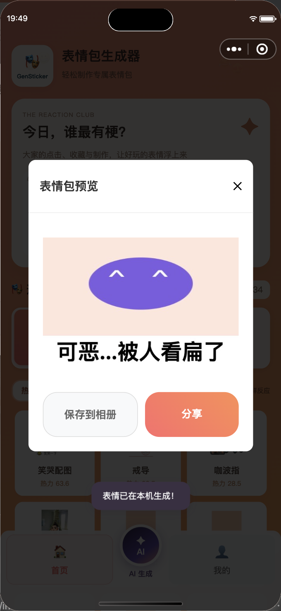

# 交互、热度与性能优化验收

此文件为上一轮优化验收记录。十个新增模板现已撤下，模板库 295 个，本机合成支持 3 个模板；最新模板与配色以 [USER_TEMPLATE_ACCEPTANCE.md](USER_TEMPLATE_ACCEPTANCE.md) 为准。

2026-10-14，分支 `codex/restore-wechat-final`。后端最后补丁已同步京东云；本机微信构建已生成 411.7 KB 的私有开发预览。未提交审核或发布生产版本。

## 完成范围

1. 构建时精确移除 uni-app 自定义导航不需要的错误阴影预加载；最终微信产物无 `shadow-grey.png` 引用，业务预载保留。
2. 底部圆形 AI 入口、呼吸光环与按压反馈已实现。模拟器实际页面栈确认进入 `pages/recommend/index`。现有九宫格流程不变。
3. 首页预载模板约束、名称和来源，详情直接打开；缩略图预取前后相邻页并限制队列和缓存，后台加载不触发前台占位。预载后的第 1 → 2 页切换实测 0 毫秒、九张预览就绪；这是缓存命中的样例。
4. 12 个模板支持本机静态合成（10 个声明式模板、JPEG 的一直 / 看扁）。受限 JSON 由已打包 Canvas 渲染器处理，素材、像素与画布有资源边界，完成释放；超限、GIF、复杂模板或不兼容设备回退服务器。本机成功统计异步发送。AI 照片分析和九宫格仍由服务器执行。
5. 来源置于详情最底部，左上角星标收藏。首页增加真实热度前三、热榜 / 探索及冷启动提示；卡片、弹窗、结果和导航增加轻量动效，支持减少动态效果偏好。
6. 点击、收藏、成功制作和 AI 事件分别计数、去重、限流。热度参考北京时间近七个自然日、三天半衰期与平滑转化率；累计次数长期保留。新任务标识 `tags-position-heat-v3`；热度仅占推荐的一部分，输入兼容性、情绪匹配、个人偏好和多样性继续生效。
7. 确定性服务端生成缓存最多 16 项 / 8 MB / 120 秒，按用户隔离；自动清理，不开放公共私有结果缓存。取消后不再展示迟到结果，失败保留输入。
8. ChineseBQB 发现了 18 个候选元数据，许可待核验，未下载或公开图片；爱给与闪萌保留逐素材许可核验路径，尚未批量接入。Wikimedia 连接故障仍重试。未宣称覆盖全网热门榜。
9. Skill 采用 `caption-preserved-v2`：保留主体表情 / 动作 / 场景，仅转换可靠边缘反应文字，检查重建、固定区域、感知重复与文字意图。复杂遮挡、动画、低置信度 OCR 暂不发布。早期主体替换样例保留手动兼容，排除 AI 自动推荐。趣味性筛选当前是规则启发式，仍需素材与反馈积累。

## 验证证据

- 本地和部署服务器均通过 16 项功能测试；服务器另通过 5 项账户测试。
- 六组前端回归通过，包含平台上传、失败 / 限速处理、取消迟到结果、缓存隔离、推荐幂等、端侧渲染资源释放与分页占位。
- 微信和 H5 构建通过；最终微信产物检查无错误阴影图片引用。
- 新合成测试图验证一直约 59 毫秒、看扁约 21 毫秒，均显示“表情已在本机生成”；另一个预载声明式模板约 32 毫秒。以上为单次模拟器测量，不是冷启动、真机或并发 p95 保证。
- 公网 `/healthz` 正常，模板 304 个，个人网站 HTTP 200。API、worker、采集 timer、Nginx、Tunnel、个人网站服务均 active。
- 真机请覆盖照片选择、GIF 回退、登录、相册授权与保存、页面切换和弱网；扫码预览不等于生产发布。

 

## 提交与回滚

本轮提交逐步推送，每个提交均可单独回退：`fe03a8a` 阴影修复、`a4a71b4` 导航详情、`744704a` 翻页、`9b9f8ee` 热度、`1fb55d5` 端侧合成、`bb6cf0e` 预载、`669f56e` 来源和质量、`7fb4d09` 静态布局、`e6f7278` UI、`e6df881` 限流 / 私有缓存、`4b172e1` 取消处理、`0659f3e` 热度窗口 / AI 质量、`5e5c592` 即时详情。

服务器升级前源码备份为 `/opt/gensticker/backups/pre-optimization-20261014/source.tgz`，Nginx 备份同目录 `nginx.conf`。只回滚应用源码时停止 GenSticker API / worker，恢复对应源码，再启动并验证；Nginx 恢复后先 `nginx -t` 再 reload。保留账户和功能数据库及私有文件，新增统计表可以保留；不要删除业务数据库来回滚代码。前端按对应 Git 版本重新构建并重新生成开发预览。

临时二维码不进入 Git，测试图片为合成图，没有公开用户照片或认证凭据。
